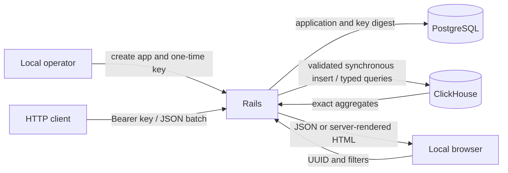

# PulseLens — architecture and completion evidence

PulseLens demonstrates a small, synchronous Rails event analytics system for local synthetic data. It intentionally separates transactional metadata from analytical scans:

PostgreSQL provides indexed, unique key-digest lookup and application metadata; it does not store events. ClickHouse's MergeTree stores append-only synthetic events, partitioned monthly with a date-first application-scoped sorting key. The chosen order supports mandatory application/date predicates and optional dimension filters; see the README for the measured granule comparison, which is not a latency measurement. Rails authenticates and validates the entire batch before one synchronous insert; it only reports 201 after confirmation. There is no automatic retry or cross-store transaction. Lost responses can leave an unknown write outcome; repeated submissions may duplicate events. Both analytics surfaces use the same typed queries and exact `uniqExact` aggregation. Rails fills zero-valued UTC days; daily uniques are not summed to compute range uniques. The three sequential queries do not promise a consistent snapshot during concurrent inserts.

The dashboard uses server-side application selection with no API keys in browser requests. It is intentionally local-only, without user accounts or public authentication. See README for explicit limits, dependency deadlines, recovery and other non-goals.

## Clean-checkout walkthrough

1. Clone the repository, choose the pinned Ruby and Bundler, configure `.env`, and run `bin/setup && bin/dev` following README. Check `/up` and `/ready`.
2. Create a separate HTTP demo application with `applications:create`, keep its one-time key private, and run the README ingestion and analytics curl examples; expect 201/accepted 1, then exact matching analytics. Open the local dashboard, select that app and the documented date range. Do not paste keys into issues or logs.
3. Create two new applications for the generator, run the documented one-million-event command once with their ordered UUIDs, and select the full November range in the dashboard. Expect 666,666 and 333,334 events and 256 unique users each. Try dimensions and an empty range. Do not add HTTP demonstration events to the benchmark pair.
4. Run `RUN_SERVICE_SPECS=1 bin/check` and follow the controlled outage instructions if needed; the tests use separate databases and outages stop local services temporarily. Follow the [query benchmark procedure](query-benchmark.md) for both runs. No destructive reset is required. For an already populated demo, benchmark the existing clean pair instead of appending again.

## Requirements evidence

Source [issue #1](https://github.com/szymoniwacz/pulselens/issues/1), approved [FR-001–013](../.ai/docs/project-requirements.md), and [integration coverage](integration-coverage.md). The merged #10 product CI at `8ccaf72` ([run 45689869882](https://github.com/szymoniwacz/pulselens/actions/runs/45689869882)) is baseline evidence; final #11 CI is still required.

| Requirement | Evidence / status |
|---|---|
| FR-001 | #4 / PR #16; creation task, authentication, digest and log tests; operator command run locally |
| FR-002 | #5 / PR #15; versioned schema and real ClickHouse round-trip |
| FR-003 | #6 / PR #19; whole-batch validation, reserved fields, zero writes for rejection, no retry |
| FR-004 | #6; normalization, defaults and exact field/body limits |
| FR-005 | #6/#10; request contracts and real stopped-store tests |
| FR-006 | #7 / PR #17; bounded UTC filters, typed binding and app isolation |
| FR-007 | #7; exact counts, UTC zero-day fill, top-ten ordering and boundary fixtures |
| FR-008 | #8 / PR #20; API parity tests, owner local screenshots of both apps, filters, zero results and keyboard navigation; complete browser-network and manual outage inspection not observed |
| FR-009 | #9 / PR #18; deterministic bounded generator, million-event CI, local generation confirmed; full local stored preflight pending benchmark |
| FR-010 | #3/#5; clean service setup, schemas, explicit deadlines and real outage tests; local setup and dashboard startup observed |
| FR-011 | #10 / PR #21; end-to-end Rails request stack with real stores, coverage matrix and green CI; no latency gates |
| FR-012 | README and this walkthrough cover required topics; clean-checkout HTTP demo replay and final validation evidence pending |
| FR-013 | Reproducible benchmark procedure and runner prepared; raw measured query results and independent repeat pending |

## Source MVP completion criteria

- Clean setup, operator key creation, generation, correct dashboard: owner performed local setup and generation on the #8 review branch. CI exercises clean service setup and the complete operator-to-ingestion-to-analytics/dashboard request path. Final clean-checkout HTTP curl walkthrough is still to be recorded; request-stack integration is not a substitute for actual TCP/browser observation.
- Tests pass in CI: baseline #10 green; final review head must pass relevant CI, including separate benchmark verification.
- Reproducible documented performance: local and CI generator measurements exist; query results must be collected and compared before declaring completion.

Keep this assessment honest: no public deployment, no personal data, no queues, no arbitrary performance guarantees or PostgreSQL comparison. Do not mark #11 complete until actual benchmark reports and remaining walkthrough evidence are recorded.
